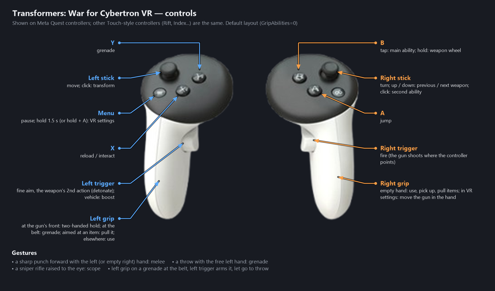

# TWFC-VR

**English** | [Русский](README.ru.md)

A VR mod for **Transformers: War for Cybertron** (2010, PC, Unreal Engine 3, 32-bit, DirectX 9).
It runs through OpenXR (tested with Virtual Desktop and Quest controllers).

- first-person view, stereo (both eyes from the same game tick), head tracking;
- the robot's arms follow your controllers (IK), aiming with the controller, two-handed grip;
- weapon wheel, grenades from the belt, pulling items to your hand, melee by swinging;
- HUD on a floating panel, VR button hints, a settings menu inside the headset;
- movies and menus on a virtual screen.

Download: **[TWFC-VR-Setup.exe](https://github.com/liper76/TWFC-VR/releases/latest)** — see [Installation](#installation)
and [Controls](#controls).

## Language

English and Russian. Switch in the VR settings menu: **Language / Язык**.

## How it works

The mod is a proxy `xinput1_3.dll` that the game loads. It patches the engine (MinHook), separates the HUD,
takes the frames from D3D11 (the game renders through dgVoodoo: D3D9 → D3D11) and hands them to OpenXR.
Details: [_vrmod/HANDOFF.md](_vrmod/HANDOFF.md); work log: [_vrmod/PROGRESS.md](_vrmod/PROGRESS.md)
(both in Russian).

The repository lives right in the game folder, but holds only the mod's files (see `.gitignore`):

```
README.md / README.ru.md     this page (English / Russian)
VR mod - instructions.txt    player guide (controls, settings)
VR-мод — инструкция.txt      the same in Russian
Launch VR.bat                starts the game with the mod (same as Запуск VR.bat)
Launch VR (classic).bat      starts the old third-person version (same as Запуск VR (классика).bat)
BinariesVR/dgVoodoo.conf     dgVoodoo settings used by the mod
_vrmod/src/                  mod sources (C++)
_vrmod/build.bat             builds and installs into BinariesVR
_vrmod/tools/                analysis tools (Python), MockXR (a fake OpenXR runtime), test scripts
_vrmod/snapshots/            a snapshot of the classic version's sources
```

## Building

Requirements: VS 2022 Build Tools (x86); in `_vrmod_tools\` next to `_vrmod\`: MinHook 1.3.4
(`minhook\minhook-1.3.4`) and the OpenXR SDK (`openxr\include`, `openxr\Win32\lib|bin`).

```
cmd /c "_vrmod\build.bat"
```

This builds `xinput1_3.dll` and copies it, together with `openxr_loader.dll`, into `BinariesVR\`.

## Installation

1. Download **TWFC-VR-Setup.exe** from [Releases](https://github.com/liper76/TWFC-VR/releases/latest).
2. Run it. It finds the game folder by itself (Steam, the usual folders); otherwise pick the folder that
   holds `Binaries\TWFC.exe` with **Browse**. Press **Install**.
3. Start your OpenXR runtime (Virtual Desktop, Quest Link / Air Link, SteamVR...) and connect the headset.
4. Start the game with the **Transformers WFC VR** shortcut on the desktop, or `Launch VR.bat` in the game folder.
5. In the headset: hold **Menu** for 1.5 s for the VR settings (language, height, sizes...).

What the installer does: makes `BinariesVR\` next to the game's `Binaries\` (a copy of the game's exe and DLLs,
the exe with the Large Address Aware flag so heavy levels don't run out of memory) and adds the mod
(`xinput1_3.dll`), `openxr_loader.dll` and dgVoodoo 2 (`D3D9.dll` + `dgVoodoo.conf`). The original `Binaries\`
folder (and your ReShade, DLSS etc. there) is left untouched; the normal game starts as before.
Reinstalling keeps your settings (`BinariesVR\twfcvr.ini`) unless **Reset settings** is ticked.
**Uninstall** in the same window removes everything it added.

Requirements: the PC (Steam / retail) version of the game, Windows 10/11, a PC VR headset with an OpenXR runtime.
Mod settings: `BinariesVR\twfcvr.ini` (created on first launch); log: `BinariesVR\twfcvr.log`.
The full player guide: `VR mod - instructions.txt` in the game folder.

Silent install: `TWFC-VR-Setup.exe /install "<game folder>" [/shortcut] [/reset]`, or `/uninstall "<game folder>"`.

## Controls



## For developers

The repository does not include game files, dgVoodoo, MinHook or the OpenXR SDK.
The setup is built with `_vrmod\installer\build_installer.bat` (after `_vrmod\build.bat`;
it needs only the .NET Framework 4 compiler that ships with Windows) into `_vrmod\dist\TWFC-VR-Setup.exe`.
