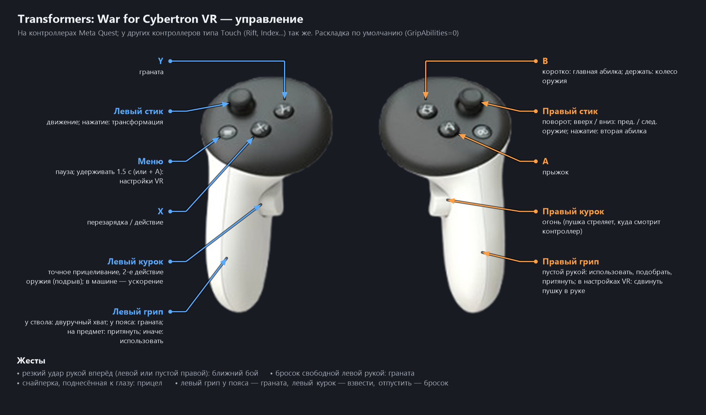

# TWFC-VR

[English](README.md) | **Русский**

VR-мод для **Transformers: War for Cybertron** (2010, PC, Unreal Engine 3, 32-bit, DirectX 9).
Работает через OpenXR (проверяется с Virtual Desktop и контроллерами Quest).

- вид от первого лица, стерео (оба глаза за один тик игры), трекинг головы;
- руки робота по контроллерам (IK), прицеливание контроллером, двуручный хват;
- колесо оружия, гранаты с пояса, притягивание предметов, удар жестом;
- HUD на плавающей панели, подсказки кнопок VR, меню настроек в шлеме;
- ролики и меню — на виртуальном экране.

Скачать: **[TWFC-VR-Setup.exe](https://github.com/liper76/TWFC-VR/releases/latest)** — см. [Установка](#установка)
и [Управление](#управление).

## Язык

Русский и английский. Переключается в меню настроек VR: **Language / Язык**.

## Как это устроено

Мод — прокси-библиотека `xinput1_3.dll`, которую загружает игра. Она патчит движок (MinHook), отделяет HUD,
забирает кадры из D3D11 (игра рендерится через dgVoodoo: D3D9 → D3D11) и отдаёт их в OpenXR.
Подробности — [_vrmod/HANDOFF.md](_vrmod/HANDOFF.md), журнал работы — [_vrmod/PROGRESS.md](_vrmod/PROGRESS.md).

Репозиторий лежит прямо в папке игры, но в нём только файлы мода (см. `.gitignore`):

```
README.md / README.ru.md     страница проекта (английская / русская)
VR-мод — инструкция.txt      инструкция игрока (управление, настройки)
VR mod - instructions.txt    то же на английском
Запуск VR.bat                запуск игры с модом (то же — Launch VR.bat)
Запуск VR (классика).bat     запуск старой версии, 3-е лицо (то же — Launch VR (classic).bat)
BinariesVR/dgVoodoo.conf     настройки dgVoodoo для мода
_vrmod/src/                  исходники мода (C++)
_vrmod/build.bat             сборка и установка в BinariesVR
_vrmod/tools/                инструменты анализа (python), MockXR (фейковый OpenXR-рантайм), скрипты тестов
_vrmod/snapshots/            снимок исходников классической версии
```

## Сборка

Нужны: VS 2022 Build Tools (x86), в `_vrmod_tools\` рядом с `_vrmod\` — MinHook 1.3.4 (`minhook\minhook-1.3.4`)
и OpenXR SDK (`openxr\include`, `openxr\Win32\lib|bin`).

```
cmd /c "_vrmod\build.bat"
```

Собирает `xinput1_3.dll` и копирует её вместе с `openxr_loader.dll` в `BinariesVR\`.

## Установка

1. Скачайте **TWFC-VR-Setup.exe** в [Releases](https://github.com/liper76/TWFC-VR/releases/latest).
2. Запустите. Папку игры он найдёт сам (Steam, обычные папки); если нет — укажите кнопкой **Обзор** папку,
   где лежит `Binaries\TWFC.exe`. Нажмите **Установить**.
3. Запустите OpenXR-рантайм (Virtual Desktop, Quest Link / Air Link, SteamVR...) и подключите шлем.
4. Запускайте игру ярлыком **Transformers WFC VR** на рабочем столе или `Запуск VR.bat` в папке игры.
5. В шлеме: **Menu** удерживать 1.5 с — настройки VR (язык, рост, размеры...).

Что делает установщик: создаёт `BinariesVR\` рядом с `Binaries\` игры (копия exe и DLL игры, exe с флагом
Large Address Aware, чтобы тяжёлым уровням хватало памяти) и кладёт туда мод (`xinput1_3.dll`), `openxr_loader.dll`
и dgVoodoo 2 (`D3D9.dll` + `dgVoodoo.conf`). Оригинальная папка `Binaries\` (и ваши ReShade, DLSS в ней)
не меняется, обычная игра запускается как раньше. Переустановка сохраняет ваши настройки (`BinariesVR\twfcvr.ini`),
если не отмечено **Сбросить настройки**. Кнопка **Удалить** в том же окне убирает всё, что было добавлено.

Нужно: PC-версия игры (Steam / диск), Windows 10/11, ПК-VR-шлем с OpenXR-рантаймом.
Настройки мода — `BinariesVR\twfcvr.ini` (создаётся при первом запуске), лог — `BinariesVR\twfcvr.log`.
Полная инструкция игрока — `VR-мод — инструкция.txt` в папке игры.

Тихая установка: `TWFC-VR-Setup.exe /install "<папка игры>" [/shortcut] [/reset]`, удаление — `/uninstall "<папка игры>"`.

## Управление



## Для разработчиков

В репозиторий не входят файлы игры, dgVoodoo, MinHook и OpenXR SDK.
Установщик собирается `_vrmod\installer\build_installer.bat` (после `_vrmod\build.bat`; нужен только
компилятор .NET Framework 4, который есть в Windows) в `_vrmod\dist\TWFC-VR-Setup.exe`.
